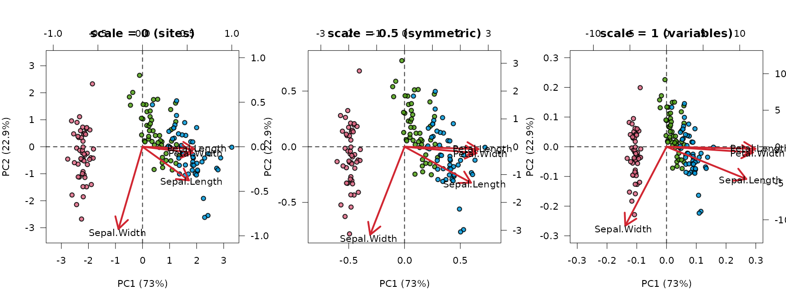
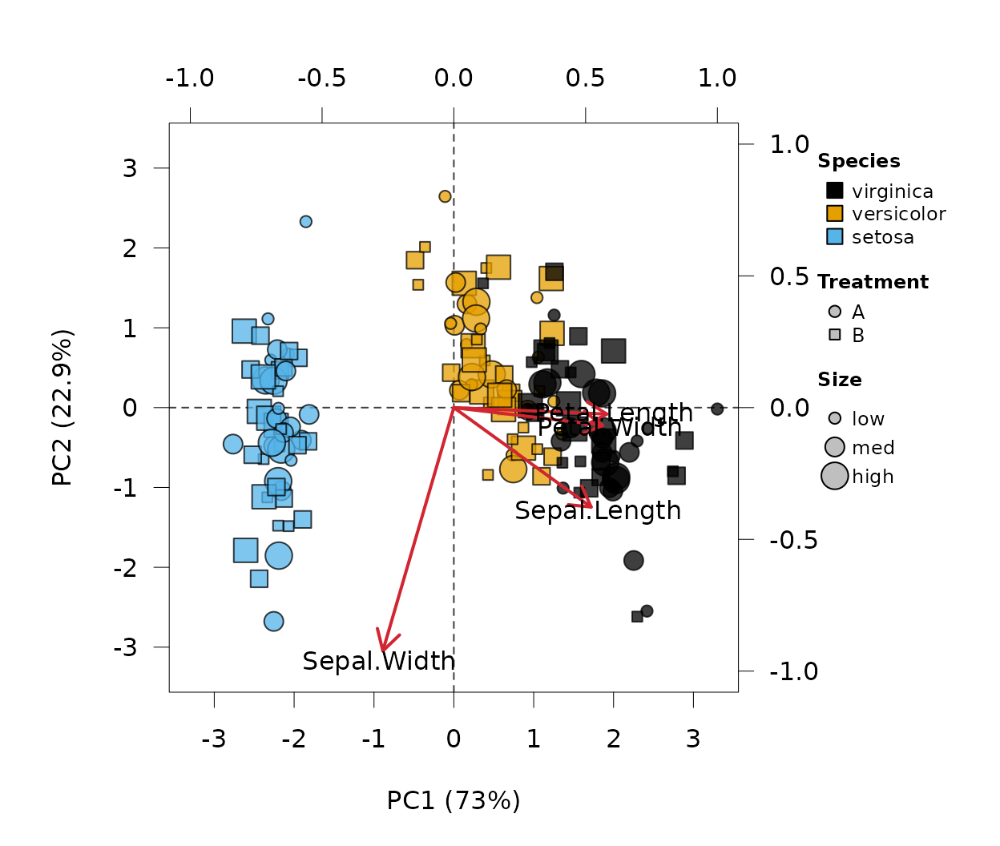
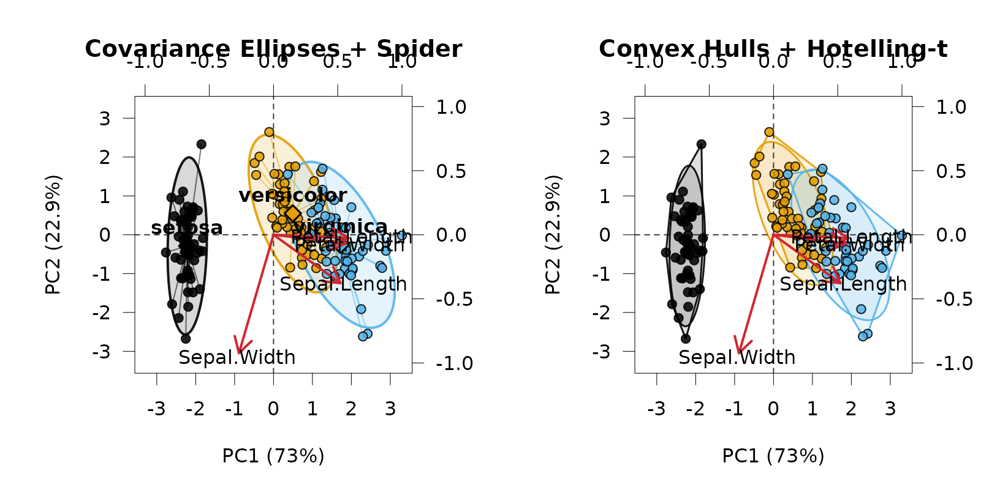
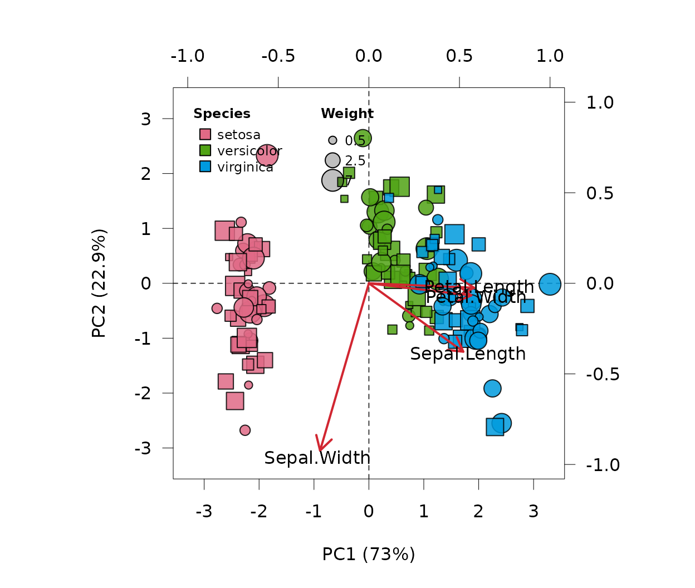
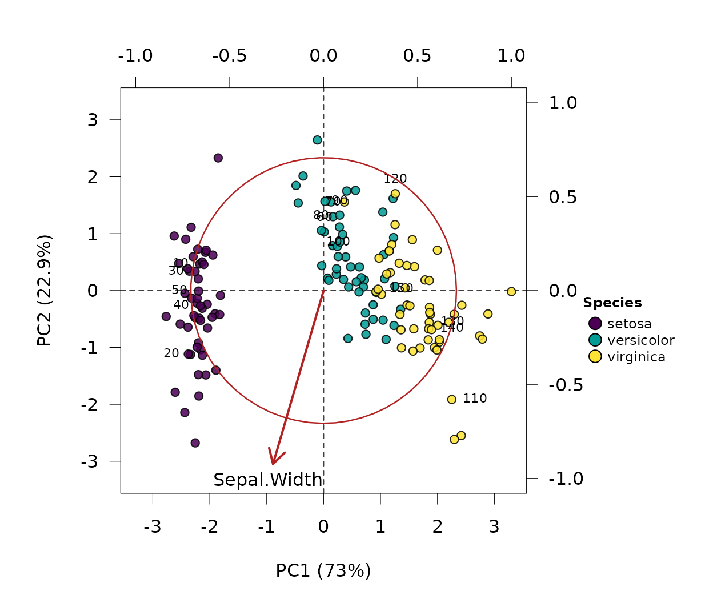
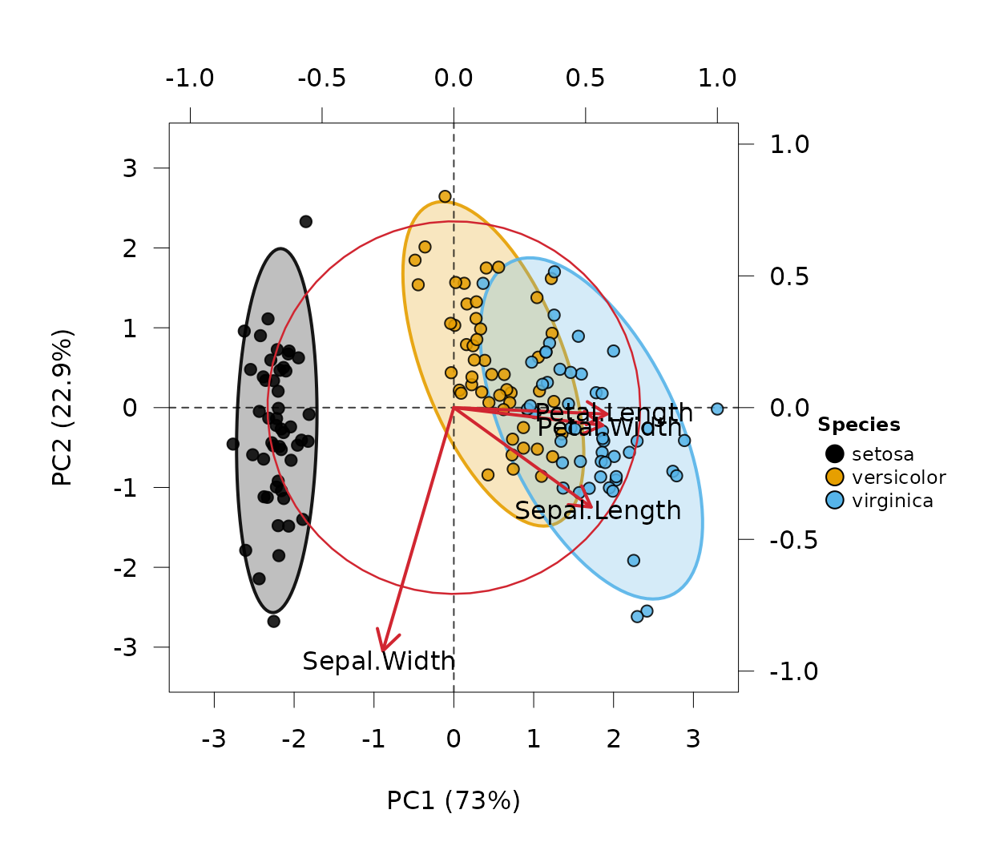
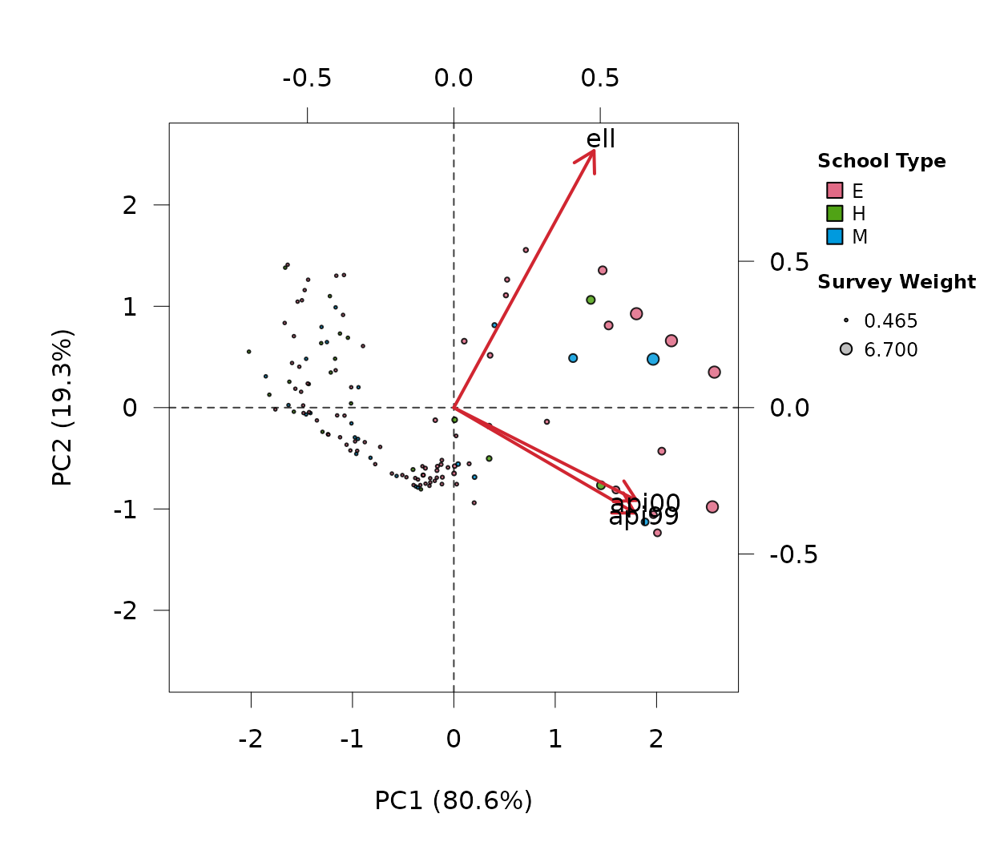
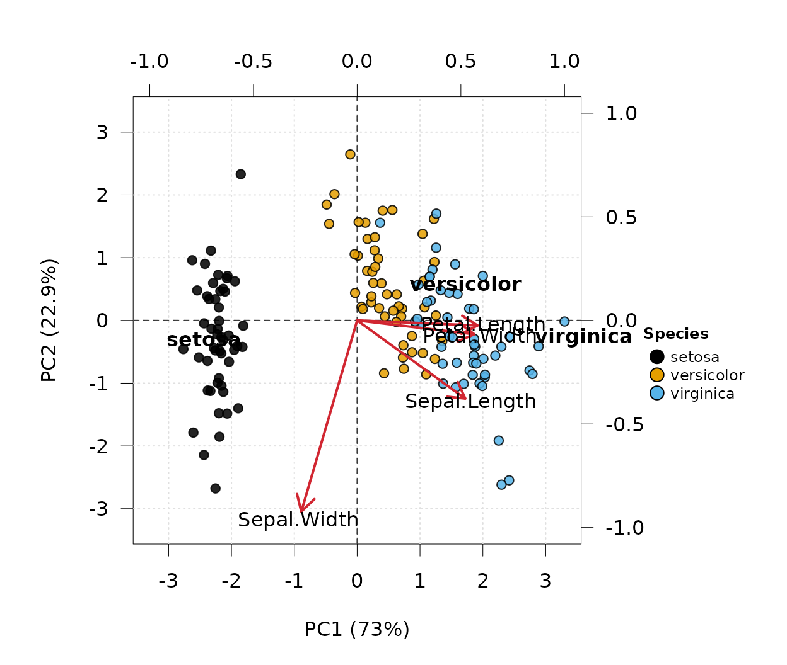

# Getting Started with betterbiplot

`betterbiplot` creates customisable Principal Component Analysis (PCA)
biplots using only base R graphics. It works with
[`prcomp()`](https://rdrr.io/r/stats/prcomp.html),
[`princomp()`](https://rdrr.io/r/stats/princomp.html),
[`vegan::rda()`](https://vegandevs.github.io/vegan/reference/cca.html),
[`survey::svyprcomp()`](https://rdrr.io/pkg/survey/man/svyprcomp.html),
`FactoMineR::PCA()`, `ade4::dudi.pca()`, and `psych::principal()`
objects, as well as custom score and loading matrices.

``` r

library(betterbiplot)
p <- stats::prcomp(iris[-5], scale. = TRUE)
gr <- factor(iris$Species)
```

## 1. Quick Start & Biplot Scaling

By default,
[`bb_biplot()`](https://benbell95.github.io/better_biplot/reference/bb_biplot.md)
matches base R [`biplot()`](https://rdrr.io/r/stats/biplot.html) scaling
(`scale = 1`, correlation biplot). Use `scale = 0` for a distance biplot
(required when drawing the circle of equilibrium contribution), or
`scale = 0.5` for a symmetric biplot:

``` r

old_par <- par(mfrow = c(1, 3), mar = c(4, 4, 3, 2))
bb_biplot(p, scale = 0, group = gr, main = "scale = 0 (sites)")
bb_biplot(p, scale = 0.5, group = gr, main = "scale = 0.5 (symmetric)")
bb_biplot(p, scale = 1, group = gr, main = "scale = 1 (variables)")
```



``` r

par(old_par)
```

## 2. Grouping, Factor Order & Palettes

Up to three grouping factors can be mapped to colour (`group`), symbol
(`group2`), and symbol size (`group3`). Existing factor
[`levels()`](https://rdrr.io/r/base/levels.html) are preserved for both
plot styling and legend order, and `col` accepts any
[`grDevices::palette.pals()`](https://rdrr.io/r/grDevices/palette.html)
or [`grDevices::hcl.pals()`](https://rdrr.io/r/grDevices/palettes.html)
palette name (such as `"Okabe-Ito"` or `"Viridis"`):

``` r

set.seed(42)
gr_ord <- factor(iris$Species, levels = c("virginica", "versicolor", "setosa"))
gr2 <- factor(sample(c("A", "B"), nrow(iris), replace = TRUE))
gr3 <- factor(sample(c("low", "med", "high"), nrow(iris), replace = TRUE),
              levels = c("low", "med", "high"))

bb_biplot(
  p, scale = 0,
  group = gr_ord, group2 = gr2, group3 = gr3,
  col = "Okabe-Ito", alpha = 0.75,
  legend = TRUE, leg.args = list(title = c("Species", "Treatment", "Size"))
)
```



## 3. Ellipses, Convex Hulls, Centroids & Spider Lines

`ellipse = TRUE` draws 95% bivariate normal covariance confidence
ellipses (`method = "cov"`) by default, or small-sample Hotelling’s
$`T^2`$ ellipses (`method = "t"`). You can also add convex hulls
(`chull = TRUE`), group centroids (`centroids = TRUE`), and radial
spider segments (`spider = TRUE`):

``` r

old_par <- par(mfrow = c(1, 2))
bb_biplot(
  p, scale = 0, group = gr, col = "Okabe-Ito",
  ellipse = TRUE, ellipse.args = list(method = "cov", level = 0.95, alpha = 0.15),
  centroids = TRUE, spider = TRUE,
  main = "Covariance Ellipses + Spider"
)
bb_biplot(
  p, scale = 0, group = gr, col = "Okabe-Ito",
  chull = TRUE, ellipse = TRUE,
  ellipse.args = list(method = "t", level = 0.90, alpha = 0.12, lwd = 1.5),
  main = "Convex Hulls + Hotelling-t"
)
```



``` r

par(old_par)
```

## 4. Selective & Condensed Legends

Use `legend` with `TRUE`/`"all"` or integer group indices
(e.g. `legend = c(1, 3)` or `legend = 3`) to show only specific legends.
`group3` legends automatically condense to minimum, middle, and maximum
symbol sizes:

``` r

gr3_many <- factor(rep(c(0.5, 1, 2, 2.5, 4, 6, 7), length.out = nrow(iris)))
bb_biplot(
  p, scale = 0,
  group = gr, group2 = gr2, group3 = gr3_many,
  legend = c(1, 3),
  leg.args = list(title = c("Species", "Weight"), horiz = TRUE, x = -3.2)
)
```



## 5. Variables, Circle of Equilibrium & Label Placement

With `scale = 0`, `circle.eq = TRUE` draws the circle of equilibrium
contribution, and
`var.args = list(which = "circle.eq", lab.offset = 1.08)` filters to
contributing variables and nudges labels past arrowheads. Set
`lab.args = list(rotate = TRUE)` for radial labels, or `pos = "auto"`
(default) for deterministic unrotated observation labels:

``` r

bb_biplot(
  p, scale = 0, group = gr, col = "Viridis",
  circle.eq = TRUE,
  var.args = list(which = "circle.eq", lab.offset = 1.1, col = "firebrick"),
  labd = ifelse(seq_len(nrow(iris)) %% 10 == 0, rownames(iris), NA),
  lab.args = list(pos = "auto", cex = 0.7),
  legend = TRUE, leg.args = list(title = "Species")
)
```



## 6. Using `vegan::rda()` and `survey::svyprcomp()`

Unconstrained
[`vegan::rda()`](https://vegandevs.github.io/vegan/reference/cca.html)
models are converted to base R `scale` (`0` to `1`):

``` r

r <- vegan::rda(iris[-5], scale = TRUE)
bb_biplot(
  r, scale = 0, group = gr, col = "Okabe-Ito",
  ellipse = TRUE, circle.eq = TRUE,
  legend = TRUE, leg.args = list(title = "Species")
)
```



For
[`survey::svyprcomp()`](https://rdrr.io/pkg/survey/man/svyprcomp.html)
objects (run with `scores = TRUE`), passing `group3 = "scaled"` sizes
points by survey weights and adds a condensed min/median/max weight
legend:

``` r

env <- new.env(parent = emptyenv())
utils::data("api", package = "survey", envir = env)
dclus2 <- survey::svydesign(
  id = ~dnum + snum,
  fpc = ~fpc1 + fpc2,
  data = env$apiclus2
)
sp <- survey::svyprcomp(~api99 + api00 + ell, design = dclus2, scale = TRUE, scores = TRUE)
bb_biplot(
  sp, scale = 0,
  group = factor(env$apiclus2$stype),
  group3 = "scaled",
  legend = TRUE, leg.args = list(title = c("School Type", "Survey Weight"))
)
```



## 7. Extending Biplots (`f1`/`f2` Hooks & Return Object)

Use `f1` / `f2` to inject base R drawing calls before points or arrows,
and capture the invisible `"bb_biplot"` return object for post-plot
annotations (resetting `par(usr = c(bp$lim, bp$lim))` when
`variables = TRUE`):

``` r

bp <- bb_biplot(
  p, scale = 0, group = gr, col = "Okabe-Ito",
  f1 = function() graphics::grid(col = "grey88", lty = "dotted"),
  legend = TRUE, leg.args = list(title = "Species")
)
par(usr = c(bp$lim, bp$lim))
text(bp$centroids, labels = rownames(bp$centroids), font = 2)
```


