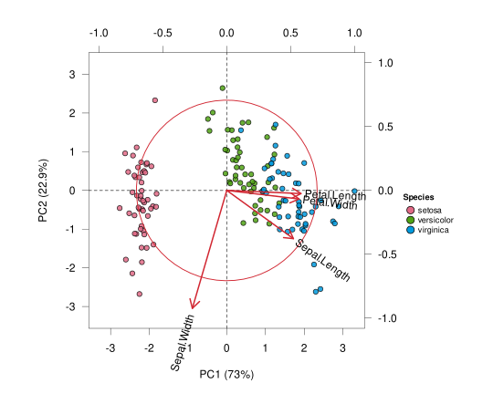
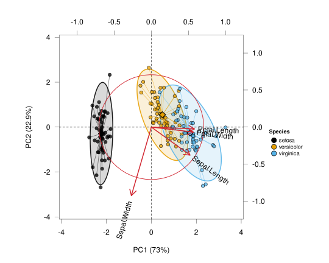

# Ben’s Better Biplot

A base R package to create beautiful looking biplots. Designed to work
with [`prcomp()`](https://rdrr.io/r/stats/prcomp.html),
[`princomp()`](https://rdrr.io/r/stats/princomp.html),
[`vegan::rda()`](https://vegandevs.github.io/vegan/reference/cca.html)
(unconstrained PCA),
[`survey::svyprcomp()`](https://rdrr.io/pkg/survey/man/svyprcomp.html),
`FactoMineR::PCA()`, `ade4::dudi.pca()`, and `psych::principal()`
objects, as well as custom score and loading matrices. The function is
compatible with the base
[`biplot()`](https://rdrr.io/r/stats/biplot.html) function, but offers
significant enhancements including new features and full customisation
of the biplot.

## Features

- Quickly create beautiful biplots from PCA results
  ([`prcomp()`](https://rdrr.io/r/stats/prcomp.html),
  [`princomp()`](https://rdrr.io/r/stats/princomp.html),
  [`vegan::rda()`](https://vegandevs.github.io/vegan/reference/cca.html),
  [`survey::svyprcomp()`](https://rdrr.io/pkg/survey/man/svyprcomp.html),
  `FactoMineR::PCA()`, `ade4::dudi.pca()`, `psych::principal()`, or
  custom matrices).
- Uses base R only - no required third-party dependencies.
- Compatible with base [`biplot()`](https://rdrr.io/r/stats/biplot.html)
  scaling and core arguments.
- Streamlined top-level API with grouped styling lists (`lab.args`,
  `var.args`, `ellipse.args`/`chull.args`, `leg.args`, `varimax.args`)
  and v1.x backwards compatibility.
- Style points by up to three groups (or `group3 = "scaled"` for
  [`survey::svyprcomp()`](https://rdrr.io/pkg/survey/man/svyprcomp.html)
  weights) and colourblind-safe palette shorthands (`"Okabe-Ito"`,
  `"Viridis"`, etc.).
- Add selective, condensed, and customisable legends.
- Add statistical covariance or Hotelling-t confidence ellipses, convex
  hulls, group centroids, and radial spider lines.
- Add circle of equilibrium contribution.
- Plays nicely with
  [`layout()`](https://rdrr.io/r/graphics/layout.html), `mfrow()`,
  [`par()`](https://rdrr.io/r/graphics/par.html), and returns plot
  coordinates invisibly for downstream base R annotations.

## Installation

Install the `betterbiplot` package from GitHub using `remotes` (or
`devtools`):

``` r

# Install betterbiplot from GitHub
remotes::install_github("benbell95/better_biplot")

# Optional: install with the vignette built (requires knitr and rmarkdown)
remotes::install_github("benbell95/better_biplot", build_vignettes = TRUE)

# Load the package
library(betterbiplot)

# View the vignette (if built)
vignette("betterbiplot")
```

## Example

Run pca analysis and plot the results. Scale the plot, style the
observations by the species, include a legend and “circle of
equilibrium” on the plot.

``` r

# pca
p <- prcomp(iris[-5], scale=TRUE)
# Group
gr <- as.factor(iris[,5])
# Plot
bb_biplot(p, scale=0, group=gr, circle.eq=TRUE, legend=TRUE, title.leg="Species", lab.args=list(rotate=TRUE))
```



Better biplot example plot

Covariance confidence ellipses, group centroids, radial spider lines,
colourblind-safe `"Okabe-Ito"` palette, and variable label offset:

``` r

bb_biplot(
  p, scale = 0, limx = 1.15, group = gr, col = "Okabe-Ito", alpha = 0.75,
  ellipse = TRUE, ellipse.args = list(method = "cov", level = 0.95, alpha = 0.15),
  centroids = "points", spider = TRUE,
  circle.eq = TRUE,
  var.args = list(lab.offset = 1.08),
  lab.args = list(rotate = TRUE),
  legend = TRUE, title.leg = "Species"
)
```



Better biplot v2.0.0 showcase

## Supported PCA Objects

[`bb_biplot()`](https://benbell95.github.io/better_biplot/reference/bb_biplot.md)
is an S3 generic with built-in methods for the following PCA objects
(none of the external packages are required to install `betterbiplot`):

| Package | Function | Class | Notes |
|----|----|----|----|
| `stats` (base R) | [`prcomp()`](https://rdrr.io/r/stats/prcomp.html) | `prcomp` | Supports `scale`, `pc.biplot`, `varimax.rotate`. |
| `stats` (base R) | [`princomp()`](https://rdrr.io/r/stats/princomp.html) | `princomp` | Supports `scale`, `pc.biplot`, `varimax.rotate`. |
| `vegan` | `rda()` | `rda` | Unconstrained PCA only; converted to base R `scale` (`0` to `1`) for compatibility. |
| `survey` | `svyprcomp()` | `svyprcomp` | Requires `scores = TRUE`. Supports `group3 = "scaled"` to size points by survey weights. |
| `FactoMineR` | `PCA()` | `PCA` | Supports `scale`, `pc.biplot`, `varimax.rotate`. |
| `ade4` | `dudi.pca()` | `pca` | Supports `scale`, `pc.biplot`, `varimax.rotate`. |
| `psych` | `principal()` | `principal` | Requires `scores = TRUE`; plots scores and loadings directly (preserving any rotation). |
| Custom matrices | `bb_biplot(x, y)` | `default` | Pass score matrix `x`, loading matrix `y`, and optional `xsd`. |

``` r

# vegan::rda() unconstrained PCA
r <- vegan::rda(iris[-5], scale = TRUE)
bb_biplot(r, scale = 0, group = gr, ellipse = TRUE, legend = TRUE)

# survey::svyprcomp() with survey-weight point sizing and condensed weight legend
sp <- survey::svyprcomp(~api99 + api00 + ell, design = dclus2, scale = TRUE, scores = TRUE)
bb_biplot(sp, scale = 0, group3 = "scaled", legend = TRUE)
```

## Compatibility

[`bb_biplot()`](https://benbell95.github.io/better_biplot/reference/bb_biplot.md)
is designed to be compatible with the output from base R
[`prcomp()`](https://rdrr.io/r/stats/prcomp.html) and
[`princomp()`](https://rdrr.io/r/stats/princomp.html) functions (as well
as the other PCA classes listed in [Supported PCA
Objects](#supported-pca-objects)), and create a biplot. It does not do
the pca itself, rather it plots the results. For the plot, data is
scaled in the same way as the base R
[`biplot()`](https://rdrr.io/r/stats/biplot.html) function, and it also
shares several arguments, so existing code should work with this
function with only minor changes.

A comparison between the arguments is shown in the table below:

| biplot() | bb_biplot() | Details |
|----|----|----|
| x, y | x, y | x should be a supported PCA object (or see section below). |
| var.axes | variables | Logical argument to plot the second set of points as arrows. |
| col | col | Colours are generated automatically, or can be specified. |
| cex | cex, lab.args, var.args | Size of data labels, variable labels, and data symbols can all be specified individually. |
| xlabs, ylabs | xlab, ylab | Axes labels (titles) are generated automatically, or can be specified. Only applies the main plot axes (e.g. bottom x axis, and left y axis). |
| expand | var.args = list(expand = …) | Adjust the size of the variable arrows. |
| arrow.len | var.args = list(arrow.len = …) | Adjust the size of the arrow heads, or suppress them. |
| xlim, ylim | limx | Plot limits for the x and y axes are generated automatically, but can be increased or decreased. |
| … | … | Additional arguments passed to the main plot. |

See [arguments section](#arguments) for a full list of available
arguments and an explanation of what they do / how they work.

Data is scaled for plotting when using supported PCA objects.
[`bb_biplot()`](https://benbell95.github.io/better_biplot/reference/bb_biplot.md)
directly supports unconstrained
[`vegan::rda()`](https://vegandevs.github.io/vegan/reference/cca.html)
objects and converts them to base R
[`biplot()`](https://rdrr.io/r/stats/biplot.html) scaling (`scale`
between `0` and `1`) for consistency across all PCA classes. If you are
used to
[`vegan::biplot.rda()`](https://vegandevs.github.io/vegan/reference/biplot.rda.html)’s
`scaling` argument, note the equivalence below:

| [`biplot()`](https://rdrr.io/r/stats/biplot.html) / [`bb_biplot()`](https://benbell95.github.io/better_biplot/reference/bb_biplot.md) | [`vegan::biplot.rda()`](https://vegandevs.github.io/vegan/reference/biplot.rda.html) | Biplot type |
|----|----|----|
| `scale = 0` | `scaling = 1` (`"sites"`) | Distance biplot (site/observation distances preserved) |
| `scale = 0.5` | `scaling = 3` (`"symmetric"`) | Symmetric biplot |
| `scale = 1` *(default)* | `scaling = 2` (`"species"`) *(default)* | Correlation biplot (variable correlations preserved) |

[`bb_biplot()`](https://benbell95.github.io/better_biplot/reference/bb_biplot.md)
can also scale the second set of data (variables) using `pc.biplot=TRUE`
in the same way as [`biplot()`](https://rdrr.io/r/stats/biplot.html).

Additionally, you can apply a further rotation to the main data
observations using `varimax.rotate=TRUE`. This uses the base R
[`varimax()`](https://rdrr.io/r/stats/varimax.html) function (see
[`?varimax`](https://rdrr.io/r/stats/varimax.html) in R for details),
which can be customised via
`varimax.args=list(normalize=TRUE, eps=1e-5)`, and applies to
[`prcomp()`](https://rdrr.io/r/stats/prcomp.html),
[`princomp()`](https://rdrr.io/r/stats/princomp.html),
[`vegan::rda()`](https://vegandevs.github.io/vegan/reference/cca.html),
[`survey::svyprcomp()`](https://rdrr.io/pkg/survey/man/svyprcomp.html),
`FactoMineR::PCA()`, and `ade4::dudi.pca()` objects.

You can also plot other data which was not created by a supported PCA
function as x and y values. `x` should be a matrix of at least two
columns for the data (e.g. “scores”), and `y` should be a matrix of the
variables (e.g. the rotation or loadings). Standard deviation values can
also be supplied using `xsd` which are used to calculate the proportion
of variance in the plot labels. This data will not be scaled by
[`bb_biplot()`](https://benbell95.github.io/better_biplot/reference/bb_biplot.md)
and should be scaled before plotting.

[`bb_biplot()`](https://benbell95.github.io/better_biplot/reference/bb_biplot.md)
is a generic function, so it can be extended to plot other pca (or any
other analysis object requiring a biplot) objects. See the source code
for details.

## To biplot (or not to biplot?)

By default, the reduced dataset principal components (e.g. the data
observations) are plotted, with the variables (loadings) plotted on top
for comparison, hence the term “biplot”. But, you can disable the second
plot of variables using `variables=FALSE`. This can be useful if you
have lots of variables, and you do not want the plot covered in variable
arrows and/or labels!

You can also control which variables are plotted using
`var.args=list(which=...)`, where you can specify either the name (exact
match) of the variable, or the index position. Additionally, if plotting
the circle of equilibrium, you can specify that only variable arrows
which extend beyond the circle are plotted. Examples:

``` r

# Disable plotting of variables
bb_biplot(p, scale=0, group=gr, variables=FALSE)
# Plot variables, but only certain ones:
bb_biplot(p, scale=0, group=gr, var.args=list(which="Petal.Length"))
# Plot variables, but only those extending beyond circle of equilibrium:
bb_biplot(p, scale=0, group=gr, circle.eq=TRUE, var.args=list(which="circle.eq"))
```

## Grouping data

[`bb_biplot()`](https://benbell95.github.io/better_biplot/reference/bb_biplot.md)
allows you to use up to three groups to style the plot points, with the
arguments `group`, `group2`, and `group3`. These are optional, and you
can style the plot without using groups, but using groups makes styling
easier and more intuitive.

Grouping data also allows [ellipses, convex hulls, centroids, and spider
lines](#ellipses-convex-hulls-centroids--spider-lines) to be plotted, as
well as allowing plot [legends](#legends) to be added.

Group objects should be a factor, with a length that matches the number
of data observations. For example, in the `iris` dataset, the fifth
column “Species” is a grouping of the data, and this can be converted to
a factor. `gr <- as.factor(iris[,5])`. If an object is supplied that is
not a factor, the function will attempt to convert it.

`group` controls the colour of the plot points. However, it can also
control the plot symbols if these are additionally specified, and
`group2` is not used. Example:

``` r

# Group 
# Changes colour of the plot points depending on the group
bb_biplot(p, scale=0, group=gr)
# Additionally change the plot symbols for each group
bb_biplot(p, scale=0, group=gr, pch=c(21, 22, 23))
```

Colours are generated automatically, or you can specify them using the
`col` argument.

`group2` controls the plot symbol (pch) for the plot points within each
group, as specified by `group` and this must also be specified for
`group2` to work. Example:

``` r

# Fake group for use in example
gr2 <- sample.int(6L, length(iris[,5]), replace=TRUE)
# Group 2
bb_biplot(p, scale=0, group=gr, group2=gr2)
```

Plot symbols are generated automatically, or you can specify them using
the `pch` argument. The number of specified symbols should be the same
as the number of groupings of data used in group2. A guide to plotting
symbols in R is available on my blog: [Quick guide to pch symbols in
R](https://www.benjaminbell.co.uk/2018/02/quick-guide-to-pch-symbols-in-r.html)

`group3` controls the size of the plot symbol (pch) for the plot points
within each group, as specified by `group` and this must also be
specified for `group3` to work, but `group2` is not required. For
[`survey::svyprcomp()`](https://rdrr.io/pkg/survey/man/svyprcomp.html)
objects, you can also pass `group3="scaled"` (even without `group`) to
scale point sizes by survey weights. Example:

``` r

# Fake group for use in example
gr3 <- sample.int(4L, length(iris[,5]), replace=TRUE)
# Group 3
bb_biplot(p, scale=0, group=gr, group2=gr2, group3=gr3)
```

Plot symbol sizes are generated automatically when using `group3` based
on the number of groupings of data used in `group3`, and are multiplied
by `cex.pt` (so `cex.pt` adjusts the base point size).

## Ellipses, Convex hulls, Centroids & Spider lines

You can add ellipses, convex hulls, group centroids, or radial spider
lines to the biplot when `group` is specified.

To add convex hulls to the plot, use:

``` r

# Convex hulls
bb_biplot(p, scale=0, group=gr, chull=TRUE)
```

To add ellipses, use:

``` r

# 95% covariance confidence ellipses (default)
bb_biplot(p, scale=0, group=gr, ellipse=TRUE)
# Small-sample Hotelling-t ellipses at 90% confidence
bb_biplot(p, scale=0, group=gr, ellipse=TRUE, ellipse.args=list(method="t", level=0.90))
```

By default, ellipses draw bivariate normal covariance confidence regions
(`method="cov"`, `level=0.95`). You can switch to small-sample F /
Hotelling’s T-squared ellipses with `method="t"`, and control fill and
border transparency via
`ellipse.args=list(alpha=0.25, border.alpha=0.9)` (or `chull.args`).

To highlight group centroids and/or draw radial spider segments from
each observation to its group centroid:

``` r

# Group centroids and spider lines with colourblind-safe Okabe-Ito palette
bb_biplot(p, scale=0, group=gr, col="Okabe-Ito", centroids=TRUE, spider=TRUE, legend=TRUE)
```

## Legends

You can add a legend, or multiple legends to the plot based on the
number of groups used. `group` is required for legends to work (except
[`survey::svyprcomp()`](https://rdrr.io/pkg/survey/man/svyprcomp.html)
objects with `group3="scaled"`, which can display a weight legend on
their own). These are generated automatically, and will match the style
of each group, and legend text is taken from the `group` arguments
(i.e. the different factors). Legend titles are also generated
automatically, although these are simply “Group” followed by the number
(or `"Weight"` for `svyprcomp()` weights). You can specify your own
titles for each group using the `title.leg` argument.

By default, `legend=TRUE` or `legend="all"` displays legends for all
supplied groups. You can also select specific groups to display by
passing group numbers (`1`, `2`, `3`), e.g. `legend=1`,
`legend=c(1, 3)`, or `legend=3`. For `group3`, the legend is condensed
to show the minimum, middle, and maximum symbol sizes (including for
[`survey::svyprcomp()`](https://rdrr.io/pkg/survey/man/svyprcomp.html)
with `group3="scaled"`). Examples:

``` r

# Legends: 1 group
bb_biplot(p, scale=0, group=gr, legend=TRUE, title.leg="Species")
# 2 groups (all)
bb_biplot(p, scale=0, group=gr, group2=gr2, legend="all", title.leg=c("Species", "second title"))
# 3 groups (all)
bb_biplot(p, scale=0, group=gr, group2=gr2, group3=gr3, legend=TRUE, title.leg=c("Species", "second title", "third"))
# Only show legend for group and group3
bb_biplot(p, scale=0, group=gr, group2=gr2, group3=gr3, legend=c(1, 3), title.leg=c("Species", "Size"))
# Only show legend for group3
bb_biplot(p, scale=0, group=gr, group2=gr2, group3=gr3, legend=3, title.leg="Size")
```

To control the order of legend items (as well as colour, symbol, and
smallest-to-largest `group3` symbol size mapping), set the factor
`levels` on your grouping variable before plotting:

``` r

# Control legend order via factor levels (instead of alphabetical order)
gr_ord <- factor(gr_values, levels=c("low", "med", "high"))
bb_biplot(p, scale=0, group=gr_ord, legend=TRUE)
```

By default, the legends are placed in the right side margin. If only 1
legend is shown, it is vertically centred, whereas if multiple legends
are shown, they are placed starting at the top of the y axis.

You can change the location of the legend(s) by using
`leg.args=list(x=..., y=...)`, to specify the absolute position using
the main plot coordinates (even when variables are plotted), for
example, to move the legends inside the plot area. You can also place
the legend in the margins by extrapolating the likely coordinates,
however, if using the bottom, left, or top margin, you must also change
the plot margins using `par(mar=c())` function before calling
[`bb_biplot()`](https://benbell95.github.io/better_biplot/reference/bb_biplot.md).
When using the right margin, this should happen automatically. You can
also horizontally align the different legends, rather than vertically
align using `leg.args=list(horiz=TRUE)`. This only works with multiple
groups. Examples:

``` r

# Legend inside plot (top left)
bb_biplot(p, scale=0, group=gr, group2=gr2, legend=TRUE, leg.args=list(horiz=TRUE, x=-3.2))
# Legend outside plot (bottom margin)
par(mar=c(12,4,4,4))
bb_biplot(p, scale=0, group=gr, group2=gr2, legend=TRUE, leg.args=list(horiz=TRUE, x=-3.2, y=-6.5))
```

You may need to resize the plot window and/or re-run the code to show
this correctly.

## Full customisation

You can customise pretty much every aspect of the plot, beyond what is
mentioned in this readme file. Refer to further examples or the
arguments section below for full details.

For example, try using `lab.args=list(rotate=TRUE)` to change how labels
are plotted.

You can also use other functions to add elements to the main plot before
the points are drawn (`f1`), and to the variables plot before the arrows
& labels are drawn (`f2`). Pass a zero-argument function
(e.g. `f1 = function() supergrid(col = "grey")` or `f1 = supergrid`).

For example, if you wanted to add a more extensive grid to the plot, you
could use my [supergrid()
function](https://github.com/benbell95/supergrid) and call this in the
main function call.

``` r

# Load supergrid script from Github
source("https://raw.githubusercontent.com/benbell95/supergrid/refs/heads/main/r/supergrid.r")

### data generated in previous example...
# Plot
bb_biplot(p, scale=0, group=gr, circle.eq=TRUE, legend=TRUE, title.leg="Species", lab.args=list(rotate=TRUE), f1=supergrid)
```

You can also add other plot elements to the biplot (after using
[`bb_biplot()`](https://benbell95.github.io/better_biplot/reference/bb_biplot.md))
using the various plot functions available in R.
[`bb_biplot()`](https://benbell95.github.io/better_biplot/reference/bb_biplot.md)
invisibly returns an object containing `scores`, `loadings`, `lim`,
`limr`, `pc`, `pvar`, `group_cols`, and `centroids` to make custom
annotations easy. Note that when `variables=TRUE`, the active plot
coordinate system is `limr` (variable axes); reset
`par(usr=c(bp$lim, bp$lim))` before drawing in score/centroid
coordinates, or use `variables=FALSE`:

``` r

bp <- bb_biplot(p, scale=0, group=gr, col="Viridis", alpha=0.6,
                var.args=list(lab.offset=1.12),
                labd=rownames(iris), lab.args=list(pos="auto"))
# Reset user coordinates to score space (bp$lim) before annotating centroids
par(usr=c(bp$lim, bp$lim))
text(bp$centroids, labels=rownames(bp$centroids), font=2)
```

## Further examples and help

More information and detailed examples on how to use this function are
available on my blog (coming soon!):
[benjaminbell.co.uk](https://www.benjaminbell.co.uk).

You can also access the built-in documentation in R using
[`?bb_biplot`](https://benbell95.github.io/better_biplot/reference/bb_biplot.md)
(or `args(bb_biplot.default)` to see all arguments and their default
values), browse the full walkthrough in
[`vignette("betterbiplot")`](https://benbell95.github.io/better_biplot/articles/betterbiplot.md),
and see [NEWS.md](https://benbell95.github.io/better_biplot/NEWS.md) for
full v2.0.0 release notes.

## Arguments

Details for the available arguments are shown in the table below.
Fine-grained styling options are grouped into `lab.args`, `var.args`,
`ellipse.args` (or `chull.args`), `leg.args`, and `varimax.args` with
sensible defaults, so you only need to override what you want to
customise.

| Argument | Details |
|----|----|
| x | Observations. Matrix with at least 2 columns. Automatically determined for supported PCA objects. |
| y | Variables. Matrix with at least 2 columns. Automatically determined for supported PCA objects. |
| xsd | Optional. Vector of standard deviation values for the variables. Automatically determined for supported PCA objects. (Used for automatic axis labels). |
| pc | Integer vector of length 2 giving the principal components to plot (default = `c(1, 2)`). |
| scale | Scale data between 0 and 1 for plotting (default = 1). This works the same way as R base biplot() function. |
| pc.biplot | Logical. Additional scaling of variables (default = FALSE). This works the same way as R base biplot() function. |
| varimax.rotate | Logical. Additionally apply varimax rotation (see ?varimax for help) (default = FALSE). Applies to prcomp, princomp, vegan::rda, survey::svyprcomp, FactoMineR::PCA, and ade4::dudi.pca objects. |
| varimax.args | Named list of arguments passed to [`stats::varimax()`](https://rdrr.io/r/stats/varimax.html) when `varimax.rotate = TRUE`: `normalize` (logical, default `TRUE`) and `eps` (numeric tolerance, default `1e-5`). |
| limx | xlim and ylim are generated automatically, but you can increase or decrease using a multiplier value (e.g. 1.5) |
| grid | Logical. Draw a grid through center x and y axes (default = TRUE). |
| col | Optional. Colours for the plot / groups, or a single palette name from [`palette.pals()`](https://rdrr.io/r/grDevices/palette.html) (e.g. `"Okabe-Ito"`) or [`hcl.pals()`](https://rdrr.io/r/grDevices/palettes.html) (e.g. `"Viridis"`). Automatically generates a palette if not supplied. |
| pch | Optional. Plotting symbols to use for the observations (also see group 2) (default symbol = 21). |
| cex.pt | Changes the size of the plotting symbols. |
| alpha | Point opacity in `[0, 1]` (default = 0.85). |
| xlab | Overwrite the default x axis label. |
| ylab | Overwrite the default y axis label. |
| axes | Logical. Plot axes (This controls all axes including variables) (default = TRUE). |
| cex.axis | Change the size of the axes, and axes labels. |
| cex | Globally change the size of all plot elements. Multiplies default or specified size of each plot element. |
| group | Optional. Groups for the data. Should be a factor, with length that matches original data. This affects the colour of the points and also allows for ellipses or convex hulls to be drawn. This will also affect the plot symbol used if multiple pch supplied, unless group2 is also specified where symbols will then relate to the second group. |
| group2 | Optional. Second grouping of data. Should be a factor, with length that matches original data. This affects the pch symbol only (e.g. multiple symbols within a single grouping). group must also be specified. |
| group3 | Optional. Third grouping of data. Should be a factor, with length that matches original data. This affects the size of the pch symbol (size automatically determined based on number of groups), and its legend is condensed to show minimum, middle, and maximum sizes. group must also be specified (but does not need group2). For [`survey::svyprcomp()`](https://rdrr.io/pkg/survey/man/svyprcomp.html) objects, can also be set to `"scaled"` to scale point size by survey weights (`sqrt(w / max(w))`, with a condensed min/median/max weight legend when legends are enabled). |
| labd | Optional. A vector of labels for the data observations, this should be the same length as the data. Use `NA` values to omit some labels. |
| lab.args | Named list of label styling options: `col` (default `"black"`), `cex` (default `0.5`), `font` (`1`–`4`, default `1`), `rotate` (logical, default `FALSE`), `ran.adj` (logical, default `FALSE`), `valign` (`0`, `0.5`, or `1`, default `0.5`), `pos` (`"auto"`, `"random"`, or `1`–`4`, default `"auto"`). |
| variables | Logical. Whether to plot the variables or not (default = TRUE). |
| circle.eq | Logical. Plot circle of equilibrium contribution (default = FALSE). Only works when scale = 0. Takes colour from `var.args$col`, and line width scales in proportion to `var.args$lwd`. |
| var.args | Named list of variable-arrow styling options: `vname` (defaults to `rownames(y)`), `which` (names, indices, or `"circle.eq"`), `expand` (default `1`), `lab.offset` (default `1.05`), `arrow.len` (default `0.15`), `lwd` (default `2`), `col` (default `"#d12631"`), `col.lab` (default `"black"`), `cex.lab` (default `1`), `font.lab` (`1`–`4`, default `1`), `axes` (logical, default `TRUE`). |
| chull | Logical. Add convex hulls to the plot - group must be supplied for this to work (default = FALSE). |
| ellipse | Logical. Draw ellipses around the data observations based on the group (default = FALSE). |
| centroids | Draw group centroids when `group` is supplied (default = FALSE). Accepts `FALSE`, `TRUE` (markers + labels), `"points"`, or `"labels"`. |
| spider | Logical. Draw segments connecting each observation to its `group` centroid (default = FALSE). |
| ellipse.args | Named list of hull and ellipse styling options (also accepted via alias `chull.args`): `method` (`"cov"` or `"t"`, default `"cov"`), `level` (confidence level in `(0, 1)`, default `0.95`), `autolim` (default `TRUE`), `nofill` (default `FALSE`), `alpha` (fill opacity, default `0.25`), `border.alpha` (border/spider opacity, default `0.9`), `lwd` (default `2`). |
| legend | Controls legend display (default = FALSE). Accepts FALSE (none), TRUE or “all” (all supplied groups), or integer values in 1:3 (e.g. 1, c(1, 3), 3) to show only selected groups. Only works when group is specified. |
| title.leg | Titles for legend groups. Can match the number of shown legends positionally, or supply titles for all groups (default = “Group”, “Group 2”, “Group 3”). |
| leg.args | Named list of legend styling options: `cex` (default `0.75`), `horiz` (default `FALSE`), `x` (optional x-coordinate), `y` (optional y-coordinate), `title` (optional title(s) if `title.leg` is omitted). |
| f1 | Run a custom zero-argument function before the main plot (e.g. `f1 = function() supergrid(col = "grey")`). |
| f2 | Run a custom zero-argument function before the variables plot. |
| … | Additional arguments passed to [`plot()`](https://rdrr.io/r/graphics/plot.default.html) (main plot only), `chull.args`, or deprecated v1.x arguments. |

## Backwards Compatibility (v1.x to v2.0.0)

In `betterbiplot` 2.0.0, fine-grained styling arguments were grouped
into `lab.args`, `var.args`, `ellipse.args` (or `chull.args`), and
`leg.args`, and `pc1`/`pc2` were combined into `pc = c(1, 2)`. Legacy
v1.x argument names continue to work via a soft deprecation shim that
emits a warning pointing to the new syntax.

**Before (v1.x):**

``` r

bb_biplot(
  p, pc1 = 1, pc2 = 3, scale = 0, group = gr,
  lab_rotation = TRUE, whichv = "circle.eq", circle.eq = TRUE,
  col.v = "navy", expand = 1.2,
  ellipse = TRUE, se = 1, nofill = TRUE,
  legend = TRUE, title.leg = "Species", horiz = TRUE, lpx = -3.2
)
```

**After (v2.0.0):**

``` r

bb_biplot(
  p, pc = c(1, 3), scale = 0, group = gr,
  lab.args = list(rotate = TRUE),
  circle.eq = TRUE, var.args = list(which = "circle.eq", col = "navy", expand = 1.2),
  ellipse = TRUE, ellipse.args = list(level = 0.95, nofill = TRUE),
  legend = TRUE, title.leg = "Species", leg.args = list(horiz = TRUE, x = -3.2)
)
```

| v1.x Argument | v2.0.0 Equivalent |
|----|----|
| `pc1`, `pc2` | `pc = c(pc1, pc2)` |
| `col.labd`, `cex.labd`, `font.labd` | `lab.args = list(col = ..., cex = ..., font = ...)` |
| `lab_rotation`, `ran_adj`, `valign` | `lab.args = list(rotate = ..., ran.adj = ..., valign = ...)` |
| `vname`, `whichv`, `expand`, `arrow.len` | `var.args = list(vname = ..., which = ..., expand = ..., arrow.len = ...)` |
| `lwd.v`, `col.v`, `col.labv`, `cex.labv`, `font.labv`, `axes.v` | `var.args = list(lwd = ..., col = ..., col.lab = ..., cex.lab = ..., font.lab = ..., axes = ...)` |
| `autolim`, `nofill`, `lwd.e` | `ellipse.args = list(...)` (or `chull.args = list(...)`) |
| `angle`, `se` | Removed (ellipses now use `ellipse.args = list(method = "cov", level = 0.95)`) |
| `cex.leg`, `horiz`, `lpx`, `lpy` | `leg.args = list(cex = ..., horiz = ..., x = ..., y = ...)` |
| `f1.a`, `f2.a` | Wrapper function, e.g. `f1 = function() fn(...)` |

## AI Disclosure

Parts of the v2.0.0 release (including converting the original human
written script into the `betterbiplot` R package, streamlining the
argument structure, adding S3 methods for additional PCA objects, fixing
bugs, writing unit tests, and updating documentation) were developed
with assistance from **Google Antigravity** (using **Gemini 4 Hydrogen**
and **Gemini 4 Neon**), with all design decisions reviewed and approved
by the author.
